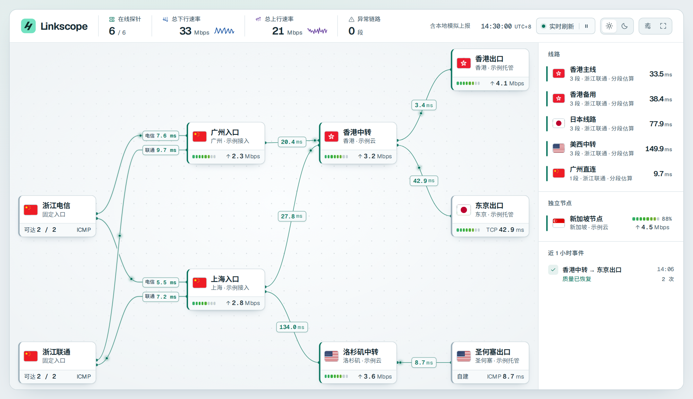
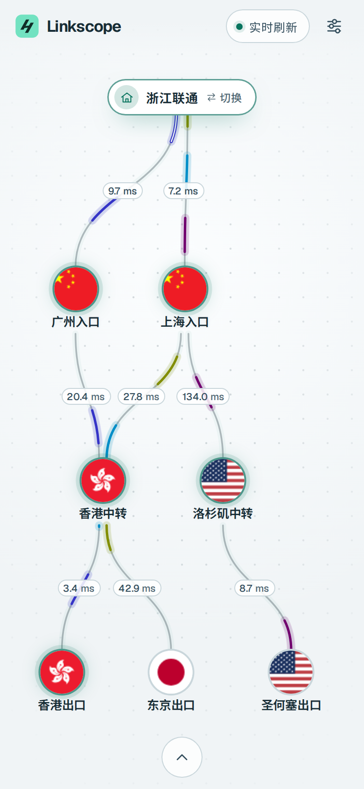
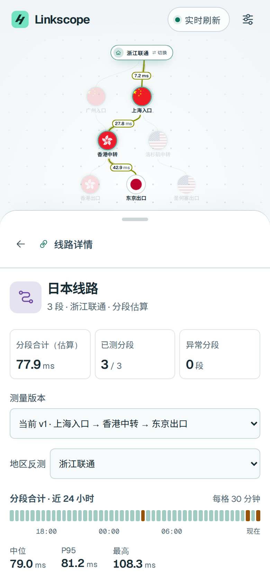

# Linkscope

网络拓扑面板、配置后台和 Linux 探针。需要 Python 3.10 或以上。页面、上报 API 与 SQLite 存储由同一服务提供。

公网拓扑、指标和历史可匿名查看，管理操作使用管理员会话，探针通过 HTTPS 和独立凭据上报。安装步骤见[公网部署与真实探针接入](deploy/README.md)。

## 界面预览

桌面拓扑、手机拓扑和线路详情均使用演示数据。

<picture>
  <source media="(prefers-color-scheme: dark)" srcset="docs/screenshots/desktop-topology-dark.webp">
  
</picture>

<p align="center">
  <picture>
    <source media="(prefers-color-scheme: dark)" srcset="docs/screenshots/mobile-topology-dark.webp">
    
  </picture>
  <picture>
    <source media="(prefers-color-scheme: dark)" srcset="docs/screenshots/mobile-route-dark.webp">
    
  </picture>
</p>

## 桌面拓扑

桌面点线路可高亮路径，再点同一条线路或画布空白处返回总览。点节点或连线可打开详情。TCP 的「延迟」指建立连接的耗时，「超时率」按最近 1 分钟计算。

拓扑按链路方向从左到右分列，同一列的顺序会尽量减少连线交叉。双向或成环的链路也从左往右画，回程那条的流动点反向移动，悬停读数可看实际方向。同一对节点之间的多条链路分开弯曲，各自显示读数。读数会避开卡片和其他读数。列数放不下时拓扑可以横向滚动。

详情打开就是全貌，不需要切换指标、链路或时段。节点详情里，主机的 CPU、内存、磁盘和上下行速率各带一条近 24 小时折线，每 30 分钟对该指标的全部有效上报取平均，百分比固定为 0–100%。每条相邻链路占一行，下面是近 24 小时状态条，每格 30 分钟。点一行进入那条链路的详情。链路详情和线路详情显示近 24 小时状态条、全天统计和近 1 小时细柱，线路详情里每个分段也各有一行状态条。细柱每根 1 分钟，从 0 起画，柱高取延迟中位数。悬停可看每格、每根的数值，这些历史每分钟更新一次。

节点间分段的颜色按该时段内出问题的轮次计算。有一轮丢包、超时或建连失败，或一轮延迟达到基线的 1.5 倍且高出 5 ms 以上，就显示琥珀色。超过一半的轮次丢包或失败、整段无回包时显示玫红色。正常的格子和柱子颜色较浅，缺测是一道浅色短条。基线是这条链路近 24 小时的延迟中位数，每 5 分钟取一个 30 秒切片，至少 12 个不同切片均有有效延迟（约 1 小时）后启用。拓扑连线用同一条规则标出延迟抬升，并计入异常链路。

浙江电信、联通的固定入口反测保留每轮实际丢包率。最近 5 轮中有 3 轮丢包，或单轮 3 个包全丢时，进入告警（琥珀色）。连续两轮全丢升为严重（玫红色），有回包后降为告警，连续 3 轮零丢包解除。停报超过 45 秒或缺少当轮丢包数据会中断连续计数。历史每格显示该时段出现过的最高告警等级，延迟抬升仍可独立触发琥珀色。

线路合计的柱高取所选入口反测和沿途分段的延迟之和在时段内的中位数。颜色同时反映这些分段的异常，切换运营商会更换入口样本。选择历史版本时，合计和分段都使用当时的路径、测量版本和截止时间。

## 手机与主屏幕

手机上整张网络画成一幅全屏的拓扑图，从上往下依次是入口运营商（启用固定入口时）、国内入口、中转、落地，分层和顺序与桌面拓扑相同。节点是圆形国旗，名字写在下面，在线探针带一圈淡光，离线节点是红色虚线圈和灰色国旗；节点大小随最拥挤的一层自动调整，从 46px 起，放不下时节点和名字一起缩小，到最小仍放不下才把最长的名字折成两行，最后才整体缩小。每段链路是一条细曲线，从上一节点名字下方出发、到下一节点圆圈边缘，几条链路在节点周围错开；已测的链路在线上标出延迟。线路用各自颜色的流光表示：一小段带微光的亮线沿这条线路经过的每段链路滑过，延迟越高越慢。线路颜色按配置顺序取四种，在日夜两种主题下都经过色弱区分和对比度校验，并避开表示状态的绿、琥珀、红；第 5 到第 8 条线路用同样的颜色画成空心流光。状态不靠颜色单独表示：有丢包、超时或无回包的链路画成琥珀或玫红的断续线，线上用图标和文字写明；还没有读数的链路画成点线。启用固定入口时，运营商画成顶部的圆角标签，点它可以在浙江电信和浙江联通之间切换，地图和线路估算一起变。首页只有这幅地图，名字都在节点下方，所以整幅图左右居中。地图背景是中间略亮、向四周淡出的淡点阵，桌面拓扑也一样；有异常或连接断开时，地图下方的翻页按钮带琥珀色或玫红色的圈。地图后面依次是线路、节点和事件三页，首尾相接：向上滑翻到下一页，从事件页再向上滑回到地图；向下滑按相反顺序翻，在地图上向下滑就到事件页。每页的大标题是这一页的汇总。线路页写线路状态，有分段异常时直接写出是哪一段，点它就打开那一段；有探针离线而线路都正常时写「线路正常」。下面每条线路一行，写延迟和近 1 小时曲线，国旗外圈和曲线用这条线路的颜色，兼作图例。节点页写离线的探针数和全网下行、上行速率，下面每个节点一行，顺序和地图从上到下一致，不在任何线路上的节点排在最后。节点的圆圈和地图上一样；主机探针写 CPU、内存、上行速率和剩余流量，离线时写最后上报的时间，没有探针的节点写对它的测量。事件页写近 1 小时的状态变化次数，同一条链路或同一台主机的变化合成一行。列表比屏幕长时可以上下滚动，滚到底后再向上滑才翻到下一页，滚到顶后再向下滑才翻回上一页；往后翻时新的一页从顶部看起，往回翻时从底部看起。三个列表页顶部的箭头回到上一页，底部按钮标出下一页的名称，手机的返回手势从任何一页都回到地图。页面跟着手指移动，松手时拖过屏幕的五分之一或快速一划就翻页；窄窗口里也可以用鼠标拖动或滚轮翻页。点线路行打开线路详情，地图只用这条线路的颜色点亮它经过的链路，并标出每段延迟；点链路、延迟、提示或节点打开链路或节点详情。详情总在地图上从底部升起，地图随之放大到这份详情涉及的链路、节点和读数，运营商标签也移到这条线的起点上方；所以从列表点开时先翻回地图，关掉详情后回到那一页原来的位置。详情里还能继续点开，返回按钮和手机的返回手势逐级退回。暂停刷新或断开时，地图上的流光停止。

在 HTTPS 面板右上角打开「面板设置 → 添加到主屏幕」。iPhone 使用 Safari 的「分享 → 添加到主屏幕」，安装后可从桌面独立启动。离线重开时显示带时间的上次公开总览，网络恢复后重新加载。离线保存的数值只有探针数、异常链路数和总上下行速率。

发布时一起更新 `dist/` 并重启面板服务，让新增资源进入静态索引。修改离线页或其预缓存资源时，同步更新 `sw.js` 的缓存版本。

## 本地预览

在项目目录运行以下命令。

```sh
python3 run_local.py
```

预览使用虚构的节点、服务商和流量数据。通过公网部署步骤安装的新面板从空拓扑开始。

打开 [拓扑](http://localhost:4186/) 或 [管理](http://localhost:4186/admin)。本机探针实际读取 Linux 的 CPU、内存、根文件系统和主网卡。独立的 `probes/simulate.py` 每 5 秒上报示例主机和客户端接入，每 30 秒上报模拟分段测量。页面每 5 秒读取后端，暂停只冻结当前页面。主机超过 15 秒没有心跳会显示离线。延迟读数保留 45 秒，给下一轮测量预留上报时间。历史按实际样本时间绘制，保留最近 24 小时。

`python3 run_local.py --no-sim` 可单独运行后端和本机探针。预览拓扑只在首次启动时从 `examples/topology.json` 初始化。管理配置、用量、历史与每个探针的写入凭据保存在 `.local-state/`。以下命令可单独启动一个空配置的后端。

```sh
python3 backend/server.py --port 4188 --state ~/.local/share/linkscope
```

服务仅监听本机回环地址。管理页可增删和编辑节点、链路及线路。先定义链路的两端和测量方，再在线路中选择接入目标并按顺序添加链路。只有接入目标的线路为直连。同一节点可在多条线路共用。调整已使用的节点或链路时，后台会检查引用和分段连续性。列表直接显示每项的实时状态，缺少探测地址或未设置测量方式的分段会被标出。主机探针的节点页列出接入命令，收到心跳后状态变为在线。删除仍被引用的节点或链路前，页面会列出引用它的线路和链路。

## 流量配额

在节点中填写本期额度和当前已用量，单位为 GiB。主机探针按上行、下行、双向合计或本期上、下行累计的较大值计量。重复上报不会重复扣量。可设置 UTC 每月重置日，遇到短月取月末，跨周期的第一份报告按相邻计数器增量开启新周期。重置日留空时可手动校准。

节点卡片用八格短条表示剩余比例，实心灰格表示已用。不限额和已设额度但用量未知的节点显示满格，悬停可看具体状态。额度未设置时显示空心格。点击节点可在「节点资料」查看用量和额度。拼车节点可选择「单向（车主计量）」，按车主提供的数据填写本期已用量。

## 实际探针

主机探针每 5 秒发送心跳，并在同一响应中核对任务。首次连接或任务变化时下发完整清单，其余轮询只返回简短确认。直连上报复用控制连接，每段 TCP 探测独立建连。接近同时完成的测量最多等待 200 毫秒合并上报，慢任务单独送达。主机历史与汇总趋势每 5 秒入库，服务使用 SQLite WAL。

管理页将节点设为「主机探针」，上报来源选「实际探针」。对应的凭据文件位于服务状态目录的 `tokens/<节点 ID>`。将 `probes/agent.py`、`probes/transport.py` 和该节点自己的凭据放到 Linux 主机上。下面示例在服务所在的本机运行。远端探针可使用已连通后端的回环转发地址。

```sh
python3 probes/agent.py --id local --token-file .local-state/tokens/local --url http://127.0.0.1:4186
```

默认从系统路由读取主网卡，可用 `--nic eth0` 指定。本地预览和公网面板都可以只依靠服务器探针运行。

### 改链后同步测量

1. 在「节点」中为要测的对端填写 IP 或主机名。TCP 建连还需要对端端口。
2. 在「链路」中选择 ICMP 或 TCP，并选择从哪一端的主机探针测量。默认随线路使用而派发。多个线路共用的分段只测一次，最后一条引用移除后撤销任务。「独立持续测量」适用于需要单独监控的链路。ICMP 需要探针所在系统提供 `ping`。
3. 在「线路」中选择经过顺序，面板按顺序汇总各段。沿途有主机探针的一端可以向仅提供代理地址的拼车落地测量 TCP 建连耗时。
4. 探针每 5 秒领取任务并发送主机心跳。新增或改链后，受到影响的探针自动领取新版任务，每 30 秒测量一轮。每个探针最多同时测 4 项，每项完成便上报。

新版本首次得到匹配的结果前显示「待测」。点所选线路的「线路详情」或某段的「链路详情」，可按测量版本查看最近 24 小时的记录。旧任务已经在途的结果按原版本归档。升级前已有的测量归入 v0。旧的 `--checks` 文件仍可给迁移时的初始任务补充未填写的目标。改链后，以后台派发的目标为准。本地文件显式填写任务的整数 `version` 时，其设置也只对该版本有效。

公网实例在面板环境中设置 `LINKSCOPE_FIXED_INGRESS=zhejiang`，拓扑始终显示「浙江电信」和「浙江联通」。两个入口代表固定的地区测点。每个担任线路首跳的主机探针每 30 秒分别向两个测点发送三次 ICMP Echo。同一首跳被多条线路共用时只测一组。即使没有访客或探针暂时离线，两张卡片仍然保留，缺少有效读数的链路显示「待测」。主机探针不再读取访客连接或按来源 IP 判断地区。

总览分别汇总在线主机网卡的上行和下行。单条线路默认使用浙江联通，详情可切到浙江电信。线路的「分段合计」将所选运营商的 ICMP 反测 RTT 与后续各段的 TCP 建连或 ICMP 延迟相加。任一段缺少有效延迟时显示「待测」。未配置地区反测的实例只合计配置的节点间分段。「已测分段」表示 45 秒内有探测结果的段数，超时也算一次探测。需要按线路统计速率时，已授权的 `access.<名称>` 适配器仍可提交客户端日志或计数器快照。固定入口的名称和位置独立于这些记录。

## 上报接口

`POST /api/v1/reports` 接受 JSON，请求头为 `Authorization: Bearer <该探针凭据>`。每个请求使用 Unix 毫秒时间戳。同一探针重复提交相同的时间戳和内容可安全重试。每个批次原子写入。服务根据拓扑配置校验可上报的主机、分段和线路。示例主机上报如下，发送时将 `at` 替换为当前时间。

```json
{"reporter":"local","at":1795489200000,"source":"system","host":{"cpu":12.5,"up":1.8,"down":3.4,"nic":"eth0","boot":1795400000000,"txBytes":1200000,"rxBytes":3400000}}
```

同一凭据可读取 `GET /api/v1/tasks?reporter=<自身 ID>&source=system`。`links` 和 `routes` 分别为分段任务和旧版客户端测试任务。默认只派发分段任务，`routes` 为空，移出的任务即撤销。每项含 `version`、`observer`、`target`、测量方法和目标。固定入口模式下，首跳主机还会在 `references` 中收到两个 ICMP 地区目标。任务清单附带 `planTag`，下次领取或在心跳中使用 `?tasks=1` 时可附加 `known=<planTag>`。收到 `{"unchanged":true}` 时，探针继续执行已有清单。分段结果回传原任务的版本、测量方和目标。例如一段 TCP 上报可写成以下形式。

```json
{"reporter":"hk-relay","at":1795489200000,"source":"system","links":{"hk-jp":{"version":3,"observer":"hk-relay","target":"jp","latency":42.3,"failureRate":0,"tcpTimeout":0}}}
```

百分比字段使用 0–100，速率使用 Mbps，延迟使用毫秒。ICMP 使用 `packetLoss`，TCP 使用 `failureRate` 标记建连失败。单次超时另记 `tcpTimeout: 100`，握手成功或收到拒绝记 0。TCP 建连超时率取最近一分钟有明确响应或超时结论的样本。旧版客户端整线任务只在面板显式设置 `LINKSCOPE_ROUTE_TESTS=1` 时允许派发和上报。公网面板使用默认关闭设置，线路图和历史统一展示分段合计。接入快照 `sessions` 附带 `routeVersions`，内容是客户端任务响应中所有 `profiles` 的 ID 与版本映射。空会话列表表示这一来源的接入已结束。

`GET /api/v1/state` 返回当前拓扑。面板附带 `?trend=all` 或 `?trend=<线路 ID>`，仅取当前视图的趋势。省略参数时返回全部趋势。`GET /api/v1/versions?kind=route&id=<线路 ID>` 列出当前和保留的旧版本，链路使用 `kind=link`。历史接口 `GET /api/v1/history?kind=route&id=<线路 ID>&minutes=60&version=3` 读取指定版本，省略版本时读取当前记录。附带 `resolution=bars` 时返回详情柱状图的数据，可用于 `link`、`peer`、`reference` 和线路的 `summary`。`points` 每项含时段中点 `t`、轮次 `n`、中位数 `p50`、最高值 `max`、平均丢包或超时 `loss`、失败轮次 `fails`、抬升轮次 `high` 和状态 `status`。响应另附窗口统计 `stats` 和基线 `baseline`。线路可用 `carrier=<地区测点 ID>` 读取所选运营商的估算。主机折线使用 `kind=host&minutes=1440&resolution=averages`，一次返回五个指标的 48 个半小时均值。柱状数据的 1 小时和 24 小时视图以及主机均值按分钟共享，结束时间向上取整到下一个整分钟，同一分钟内的请求只计算一次。后台每分钟为最近 10 分钟查看过的序列预热，最多同时跟踪 128 条。预热期间可先读上一分钟的结果，其余序列按需计算并共享。配置修订后重新计算。详情查看历史版本时携带归档标识（例如 `archive=route/main/3`），该版本的合计和分段都按归档的精确截止时间共享结果。5 分钟逐轮视图保留原始时间。

```sh
python3 -m unittest discover -s tests
```

## 使用提示

- 为拼车落地新建链路时，测量方式默认是 ICMP。要检查代理端口，请在落地节点填写端口，并在链路中选择 TCP。
- 只有一台独立探针时，可在手机的「节点」页点开它的详情。连接链路或将它设为线路入口后，首页地图也会显示它。

## 许可证

Linkscope 项目代码采用 [MIT 许可证](LICENSE)。随附的[旗帜素材](dist/flag-icons-LICENSE.txt)、[Geist](dist/fonts/geist-OFL.txt)、[Geist Mono](dist/fonts/geist-mono-OFL.txt) 和 [Noto SC](dist/fonts/noto-sc-OFL.txt) 字体保留各自的许可证。
